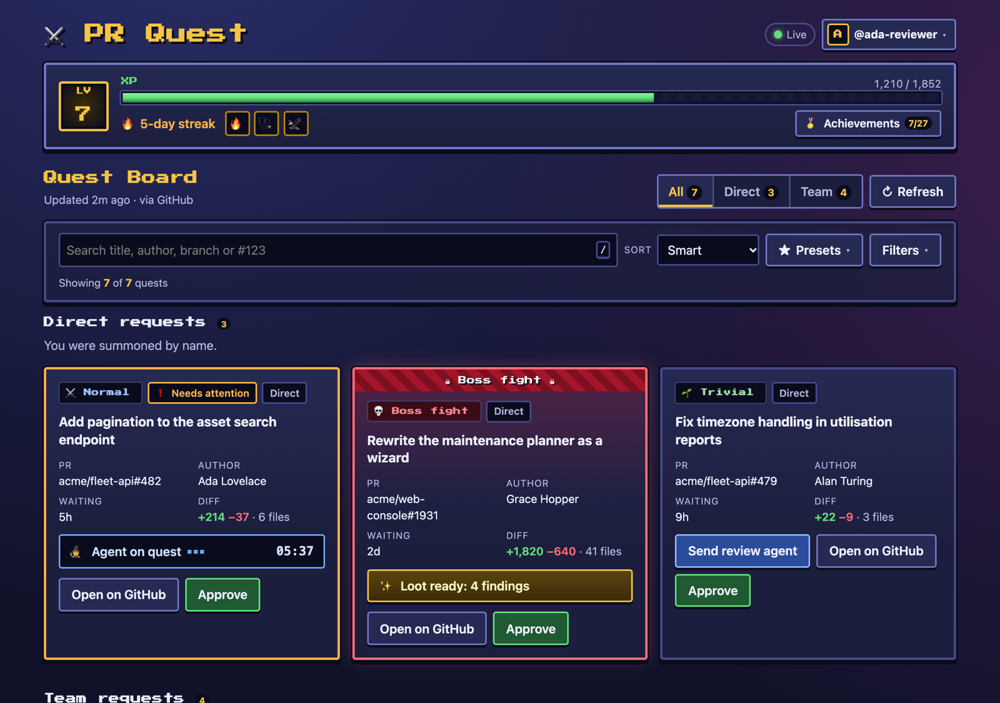
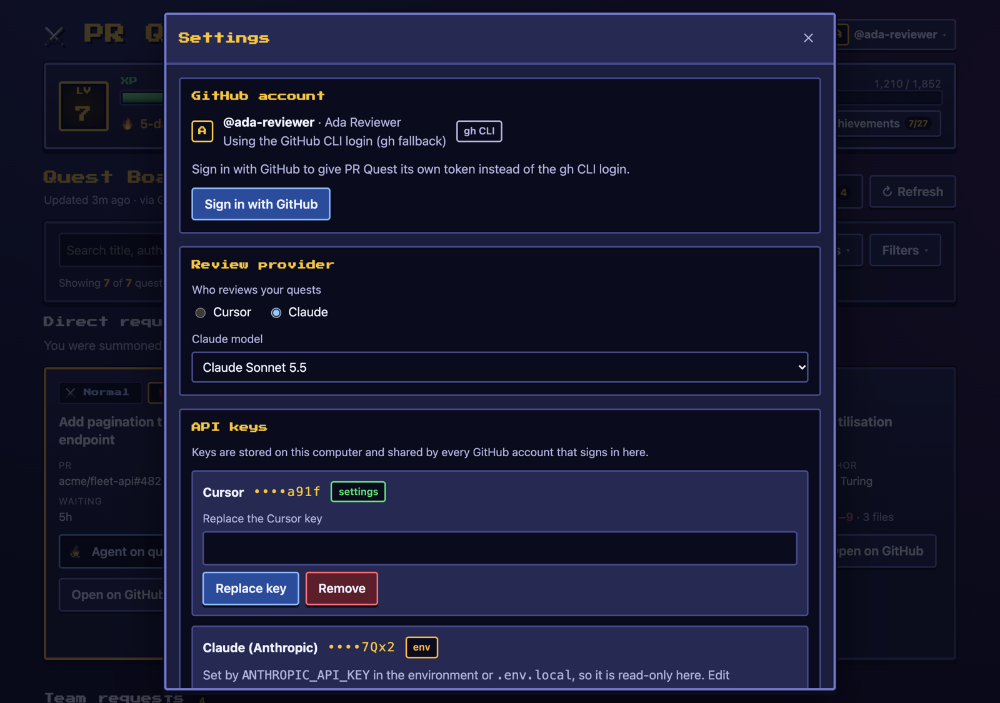
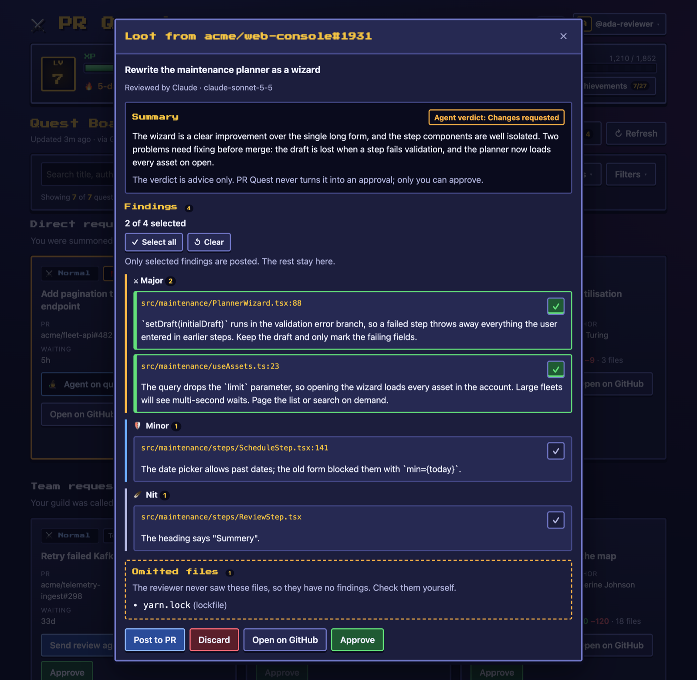
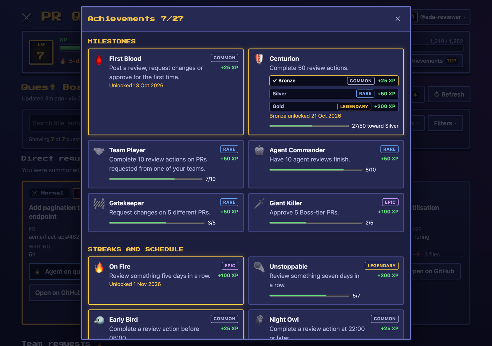

# PR Quest

PR Quest turns the pull requests you've been asked to review into a quest board. Each review
request becomes a card with a difficulty tier based on its diff size. From a card you can send a
reviewer to the PR (a Cursor cloud agent, or Claude reading the diff), choose which of its
findings to post to GitHub, and approve the PR. Real review actions earn XP, levels, a daily
streak and achievements.



The board and its server run on your machine and act as you on GitHub with your token, so the
server only listens on `127.0.0.1`. Only the reviewer runs elsewhere, in Cursor's cloud or at
Anthropic.

## Quick start

You need:

- **Node and Yarn through [Volta](https://volta.sh).** Node 24.22.1 and Yarn 4.18.1 are pinned
  in `package.json`, so Volta switches to them inside the repo.
- **A GitHub token.** The simplest is a logged-in GitHub CLI (`gh auth login`); PR Quest reads its
  token with `gh auth token`. You can also [sign in with GitHub](#sign-in-with-github) from the
  app.

```sh
gh repo clone bchTrackunit/pr-quest
cd pr-quest
yarn install
yarn dev
```

Open <http://127.0.0.1:4318>. `yarn dev` starts the API on port 4317, restarting it when the
server code changes, and the UI on port 4318 with hot reload. `yarn start` builds and runs the
[production build](docs/development.md#production-build) instead, which serves the API and the UI
together on <http://127.0.0.1:4317>. The board checks GitHub every 2
minutes and when you press **Refresh**.

## Configuration

The board, approvals and XP work without any API keys. To send reviewers, add a key for the
review provider you want, either in **Settings** (open the account chip in the top-right corner)
or in the env file `~/.pr-quest/.env`, in the [state directory](#where-state-lives):

```sh
mkdir -p -m 700 ~/.pr-quest
cp .env.example ~/.pr-quest/.env
chmod 600 ~/.pr-quest/.env
```

PR Quest warns at startup when other users may read that file.

| Variable                    | What it's for                                                                                      |
| --------------------------- | -------------------------------------------------------------------------------------------------- |
| `CURSOR_API_KEY`            | Cursor reviews. Create one at <https://cursor.com/dashboard/integrations>                          |
| `ANTHROPIC_API_KEY`         | Claude reviews. Create one at <https://console.anthropic.com/settings/keys>                        |
| `LINEAR_API_KEY`            | Optional: Linear review links and the "needs attention" flag on cards                              |
| `PR_QUEST_GITHUB_CLIENT_ID` | Enables [Sign in with GitHub](#sign-in-with-github)                                                |
| `PR_QUEST_PORT`             | API port, default `4317`                                                                           |
| `PR_QUEST_UI_PORT`          | UI port, default `4318`                                                                            |
| `PR_QUEST_STATE_DIR`        | Where PR Quest keeps its data, default `~/.pr-quest` (see [Where state lives](#where-state-lives)) |

`PR_QUEST_MODE`, `PR_QUEST_HOST`, `PR_QUEST_PUBLIC_ORIGIN`, `PR_QUEST_ALLOWED_HOSTS` and the
[hosted storage](docs/development.md#hosted-storage) settings (`DATABASE_URL` and the master keys)
belong to [hosted mode](docs/development.md#hosted-mode), which isn't usable yet.

PR Quest reads settings from three places, and the first one that sets a value wins:

1. The environment.
2. The env file in the state directory, `<PR_QUEST_STATE_DIR>/.env`. It can't set
   `PR_QUEST_STATE_DIR` itself, because it is read from there; PR Quest refuses to start if it
   tries.
3. `.env.local` at the repo root (git-ignored), read by `yarn dev` and `yarn start` from a
   checkout. It was the only env file before, so existing setups keep working, and it may set
   `PR_QUEST_STATE_DIR`. Move its other values to `~/.pr-quest/.env` when convenient.

All three win over keys saved in Settings. Setting a variable to an empty value ignores the places
below it, so the default applies; for an API key that's the key saved in Settings, so
`CURSOR_API_KEY= yarn dev` still uses a saved Cursor key. Keys from the environment or an env file
are read-only in Settings; saved keys apply without a restart. Settings never shows a
key, only whether it's set, where it came from and, for keys of 12 characters or more, its last
four characters. The key inputs ask 1Password, LastPass and Bitwarden not to save them.



Settings also picks the **review provider** (Cursor or Claude) and the model for each. With the
provider's key, the model list comes from the provider (Cursor's model list, Anthropic's
`GET /v1/models`); without it, Settings shows a built-in list. Cursor defaults to its own default
model and Claude to `claude-sonnet-5-5`. Keys, the provider and the models belong to this
computer: every GitHub account that signs in here shares them, and signing out doesn't remove
them.

### Sign in with GitHub

Without a sign-in, PR Quest uses the GitHub CLI's token, which it reads again at most every 5
minutes. "Sign in with GitHub" gives PR Quest its own token through GitHub's
[device flow](https://docs.github.com/en/apps/oauth-apps/building-oauth-apps/authorizing-oauth-apps#device-flow):
you enter a short code at <https://github.com/login/device>. It needs no client secret and no
callback, but it does need a GitHub OAuth App, which you create once:

1. On GitHub, open **Settings → Developer settings → OAuth Apps → New OAuth App** (or the same
   under an organization's settings).
2. Set **Homepage URL** and **Authorization callback URL** to `http://127.0.0.1:4318`, or your
   port if you set `PR_QUEST_UI_PORT`. GitHub requires a callback, but the device flow never uses
   it.
3. Check **Enable Device Flow**, since without it GitHub refuses to issue codes. Choose **Register
   application** and copy the **Client ID**. Don't generate a client secret.
4. Put it in `~/.pr-quest/.env` (or `.env.local`) as `PR_QUEST_GITHUB_CLIENT_ID=...` and restart
   PR Quest.

PR Quest asks for the `repo` and `read:org` scopes. OAuth Apps have no read-only scope for
private repos, so `repo` grants full access to every repo you can access. **Sign out** deletes the
token from this computer but doesn't revoke it; revoke it under
[Authorized OAuth Apps](https://github.com/settings/applications) when you're done.

Organizations such as Trackunit can restrict which OAuth Apps see their private repos. Until an
organization owner approves your app, that organization's PRs don't show up. When you authorize
the app, GitHub shows a **Request** button next to each restricted organization; you can also
request access later under **Settings → Applications → Authorized OAuth Apps**. An owner approves
it under the organization's **Third-party access → OAuth app policy**. A signed-in token wins over
the GitHub CLI, so **Sign out** to go back to the CLI's token, which Trackunit already allows.

## Using the board

Requests that name you directly are listed first, then requests that reach you through a team.
Each card's tier comes from its additions plus deletions: **Trivial** under 50 lines, **Normal**
under 400, **Hard** under 2,000 lines and 50 files, and **Boss** above that.

The bar above the cards narrows and orders the board, without calling GitHub:

- **Requests** (_All_, _Direct_, _Team_) picks which requests to show. With _All_, the board is
  grouped into direct and team requests, and the other filters and the sort apply inside each.
- **Search** matches the title, author, branch and PR number (`#123`, `repo#123` or
  `owner/repo#123`). Press `/` to jump to it.
- **Sort**: _Smart_ (direct requests, then PRs that need attention, then the longest-waiting),
  smallest or largest first, or newest or oldest first.
- **Filters**: difficulty, agent state (not started, running, loot ready, failed), and switches to
  hide drafts and PRs others already approved.
- **Presets** save the current filters and sort under a name. _Quick wins_ and _Boss rush_ are
  built in. The board remembers your last view in the browser.

## Reviewing a PR

**Summon agent** on a card starts a review with the provider chosen in Settings:

- **Cursor** starts a Cursor cloud agent that checks out the repo at the PR's head commit and
  reviews the diff with the rest of the repo as context. Because the agent can act as you, it only
  reviews PRs opened from the repo itself by members, collaborators, Dependabot or Renovate, and
  whose branch names are safe in shell commands. On other PRs the button is disabled and suggests
  Claude.
- **Claude** sends the diff, title, branch names and the PR's trusted comments to Anthropic's API,
  never the rest of the repo. Lockfiles, generated and binary files are left out, and the review
  lists any file it didn't see. Claude can't run anything or reach GitHub.

Both reviewers also get the PR's existing comments from people who can push to the repo and from
known review bots (Bugbot, Copilot, CodeRabbit), so they don't repeat what's already been said.

When the review finishes, the card shows **Loot ready**. Open it to read the summary and
findings:



No finding starts selected. Tick the ones worth posting, or use **Select all** and **Clear**.
**Post to PR** posts one GitHub review, as a comment or a change request, with the summary and the
selected findings as inline comments on the commit that was reviewed. When the reviewer wrote
replacement code, the comment is a suggested change the author can apply in one click. A finding
without a line goes on its file; findings are never listed in the review body. The rest are never
posted. With nothing selected, you can still post the summary on its own. Selecting earns no XP.
`@mentions` in the reviewer's text are escaped, so posting never pings anyone.

The reviewer's verdict is only advice. **Approve** is a separate action with its own
confirmation, pinned to the commit you saw: if new commits were pushed since, PR Quest approves
nothing and asks you to look again.

## XP and achievements

XP comes only from real review actions, never from just starting an agent:

| Action          | Base XP |
| --------------- | ------- |
| Post a review   | 20      |
| Approve         | 15      |
| Request changes | 15      |

Base XP is multiplied by tier: Trivial ×1, Normal ×1.5, Hard ×2, Boss ×3. Approving the same PR
twice earns XP once. Reaching the next level takes `100 × level^1.5` XP, and the streak counts
consecutive days, in your [time zone](docs/how-it-works.md#time-zone), with at least one rewarded
action.

There are 27 achievements, from _First Blood_ to secret ones that show as "???" until they
unlock. Each pays bonus XP once, by rarity: 25 (common), 50 (rare), 100 (epic) or 200
(legendary). The [full list](docs/how-it-works.md#achievements) explains how to unlock each one.



## Where state lives

Everything is under `~/.pr-quest`, or `PR_QUEST_STATE_DIR`. Directories are created with mode
`0700` and files with mode `0600`:

```text
~/.pr-quest/
├── .env                optional settings and keys that you write; PR Quest only reads it
├── secrets.json        the GitHub OAuth token and the API keys saved in Settings
├── settings.json       the review provider, the model per provider and the time zone
└── users/<login>/      one folder per GitHub user
    ├── state.json      XP, streak, achievements and the last 200 review runs
    └── quests.json     the last quest list, for a fast start and rate-limit backoff
```

Delete a user's folder to reset their progress. Board filters and presets live in the browser's
`localStorage`. [How it works](docs/how-it-works.md#where-state-lives) covers what happens to
unreadable or older files.

## Security

- **Loopback only.** In local mode, the default, the server listens on `127.0.0.1` and only
  accepts browser requests from its own UI, so other websites and local dev servers can't use it to act as you. It has no
  authentication, so any program running on this computer can call it.
- **Secrets stay in the server.** No route returns a key or the GitHub token. They're stored in
  plain text in `secrets.json`, protected only by its file mode.
- **The Cursor agent's limits are only in its prompt.** It runs with your Cursor identity and
  GitHub integration, and is told never to commit, push, comment or approve. A prompt injection in
  the PR could talk it out of that; the only hard guard is that the SDK won't open a PR for it.
  Prefer Claude for PRs whose content you don't trust, including dependency bumps from upstream
  releases you don't trust.
- **Nothing reaches GitHub until you choose it.** PR Quest never turns a reviewer's output into an
  approval, and only posts the findings you selected.

[How it works](docs/how-it-works.md) describes the GitHub calls, the reviewers' safeguards and
these protections in full.

## Privacy

PR Quest has no server of its own and collects nothing. It sends your data only to the services
you use it with, under your own accounts and keys:

- **GitHub** gets the API calls described in [How it works](docs/how-it-works.md), made with your
  token.
- **Cursor** gets the PR to review when you send a Cursor review agent, under your Cursor API key.
  The agent reads the repo through your Cursor GitHub integration.
- **Anthropic** gets the PR's diff, title, branch names and trusted comments when you send a
  Claude review, under your Anthropic API key.
- **Linear** gets a request for your pending reviews, under your Linear API key, if you set one.

Nothing goes to the author of PR Quest: there is no telemetry, analytics or crash reporting. Each
provider's own terms and privacy policy cover what it does with what it receives. Your state,
settings and saved keys stay in the [state directory](#where-state-lives) on your machine.

## Known limitations

- **"Waiting" counts from when the PR was opened**, because GitHub's search doesn't say when you
  were asked to review. Quick Draw is harder to get than intended for the same reason.
- **A team request lists every team** requested on the PR, not only the ones you belong to.
- **Linear with a personal API key is unverified.** Approving always goes through GitHub, since
  Linear's API has no approve mutation (see [the spike](docs/spike.md)).
- **Reviewers see at most the newest 100** review summaries, inline threads and conversation
  comments, so on a busy PR they may repeat an older one.
- **Switching GitHub users stops that user's running reviews**, rather than finishing them as the
  new user.
- **Posted reviews match no Agent filter**, so selecting any agent state hides those PRs.
- **The Cursor fallback model ids are unverified.** Without a Cursor key, the model list is
  PR Quest's built-in guess; with a key, it comes from Cursor.

## Development

| Command          | What it does                                                     |
| ---------------- | ---------------------------------------------------------------- |
| `yarn dev`       | Runs the API (restarting on changes) and the UI                  |
| `yarn build`     | Builds the UI and bundles the server                             |
| `yarn start`     | Builds, then runs the production build on port 4317              |
| `yarn test`      | Runs every package's Vitest suite once                           |
| `yarn typecheck` | Type-checks each package and its tests with TypeScript 7         |
| `yarn lint`      | Lints with oxlint, including type-aware rules and project rules  |
| `yarn format`    | Formats with oxfmt                                               |
| `just check`     | Everything CI runs: type check, lint, format check, tests, build |

The repo is a set of Yarn workspaces: the server in `apps/server`, the React UI in `apps/web`,
and the types and routes they share in `packages/contract`.
[Development](docs/development.md) covers the tooling, the production build, the project
structure and its import rules, and how to move a branch from the old `src/` layout.

## License

PR Quest is released under the [MIT License](LICENSE).
