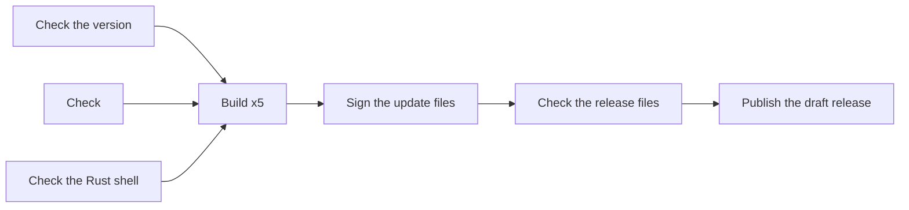

# Releasing the desktop app

[`.github/workflows/release.yml`](.github/workflows/release.yml) builds the Tauri desktop app on
every platform, signs and checks it, signs its update files, writes the updater's `latest.json`,
and puts it all in a draft GitHub Release. Nothing reaches users until you publish that draft by
hand.

## How a release runs

Pushing a tag that starts with `v` runs these jobs:



1. **Check the version.**
   - The `version` in `apps/desktop/package.json` must look like `0.2.0`, or `0.2.0-beta.1` for a
     prerelease, and `apps/desktop/src-tauri/Cargo.toml` must have the same one.
     `apps/desktop/src-tauri/tauri.conf.json` must take its version from that `package.json`
     (`"version": "../package.json"`), which is the version the app reports to its updater. Dry
     runs check this too.
   - The tag must be `v` followed by that version, and the tagged commit must be on the default
     branch. The dry run's opt-out from code signing, `PR_QUEST_ALLOW_UNSIGNED_RELEASE`, must not
     be set.
   - It stops if any signing secret's name is a repository or organization secret it can see;
     see [Secrets and settings](#secrets-and-settings).
   - The repository variable `PR_QUEST_UPDATER_PUBKEY` must be a Tauri updater public key, and
     not the development key in `tauri.conf.json`. A tag build also needs the variables
     `APPLE_TEAM_ID` and `WINDOWS_SIGNER_SUBJECT`, which the build jobs check the signatures
     against; see [The variables](#the-variables).
2. **Check.** Type-checks, lints, checks formatting and runs the tests: `just check` without its
   build, since every build job builds anyway.
3. **Check the Rust shell.** `just desktop-check` (rustfmt, Clippy and the Rust tests) and
   `just cargo-deny`, which audits the crates for advisories and licenses. Cargo runs with
   `--locked`, so a `Cargo.lock` that wasn't updated with the version stops it.
4. **Build**, once per target, each on a runner with that processor, since `yarn install` fetches
   only the runner's own Cursor SDK binaries:

   | Job         | Runner             | Target                      |
   | ----------- | ------------------ | --------------------------- |
   | macOS arm64 | `macos-15`         | `aarch64-apple-darwin`      |
   | macOS x64   | `macos-15-intel`   | `x86_64-apple-darwin`       |
   | Windows x64 | `windows-2025`     | `x86_64-pc-windows-msvc`    |
   | Linux x64   | `ubuntu-22.04`     | `x86_64-unknown-linux-gnu`  |
   | Linux arm64 | `ubuntu-22.04-arm` | `aarch64-unknown-linux-gnu` |

   Linux builds on Ubuntu 22.04, the oldest image GitHub offers, so the AppImage and `deb` run on
   every distribution with its glibc or newer.

   The macOS and Windows build jobs of a tag build use the `release` environment, so they wait
   until a reviewer approves them; see [Protect the signing secrets](#protect-the-signing-secrets).
   The Linux jobs sign nothing and need no secrets, so they don't use it. No build job ever gets
   the updater's private key.

   Each job runs [`scripts/ci/package.sh`](scripts/ci/package.sh) twice, as a release build
   (`PR_QUEST_RELEASE_BUILD=1`, with `PR_QUEST_RELEASE_REPO` set to the repository the workflow
   runs in, and `PR_QUEST_UPDATER_PUBKEY`):
   - **Compile**, with no secrets at all: `just desktop-package --compile-only` runs `yarn build`,
     lays out the sidecar and compiles the shell with `tauri build --no-bundle`. This is where
     the dependencies' code runs: Vite and its plugins, every crate's build script and procedural
     macro. `package.sh` stops if it finds any signing secret here.
   - **Bundle**, with only its own platform's signing secrets: `--skip-compile` sets up signing,
     signs the sidecar's native code and runs `tauri bundle`, which signs (and on macOS
     notarizes) the app and the installer. The Tauri CLI and `package.sh` run here with the
     secrets, since they do the signing; nothing is compiled. A release build stops on macOS and
     Windows without signing, and leaves a record of how it was signed next to the bundles.

   Then each job:
   - collects the installers and update files under the release's file names, with
     [`scripts/ci/collect-bundles.sh`](scripts/ci/collect-bundles.sh). On macOS it makes the
     update archive itself, a `tar.gz` of the stapled app in the format Tauri's bundler writes
     and the updater unpacks: a GNU tar with `PR Quest.app` as its only top folder, symbolic links
     kept, and no extended attributes or AppleDouble (`._`) files;
   - on every tag build, checks the signatures, whatever `package.sh` reported. On macOS: the code
     signature, Gatekeeper's verdict, the stapled notarization and that the team is
     `APPLE_TEAM_ID`, for the app and again for the app unpacked from the update archive. On
     Windows: it installs the app and checks that every `.exe`, `.dll` and `.node` file in it,
     and the installer, is validly signed by `WINDOWS_SIGNER_SUBJECT`, then uninstalls it. The
     bundled Node, `pr-quest-node.exe`, only has to be validly signed: it keeps the OpenJS
     Foundation's signature, which Tauri doesn't replace;
   - smoke-tests every bundle with `just desktop-smoke`: the app and the `dmg` on macOS, the
     AppImage and the `deb` under `--headless` on Linux, and the installer on Windows;
   - uploads the files.

5. **Sign the update files.** The only job that gets the updater's private key. It uses the
   `release` environment in a tag build, so it waits for a second approval. It checks out
   nothing but [`scripts/ci/sign-updates.sh`](scripts/ci/sign-updates.sh) and runs no Yarn or
   Cargo: the script downloads the Tauri CLI's own release binary (2.12.4, the version the app
   builds with) and minisign 0.12, each checked against a pinned SHA-256. It first signs and
   verifies a probe, so a private key that doesn't match `PR_QUEST_UPDATER_PUBKEY`, or a wrong
   password, stops it before anything is signed. Then it signs the five update files with
   `tauri signer sign --app-version <version>`, as `tauri build` would, so each signature's
   trusted comment ends in `version:<version>`, verifies each with minisign, and uploads only
   the `.sig` files.
6. **Check the release files.** Gathers what the five builds made and the signatures, and stops
   at a missing, unexpected or duplicate file, or at a build record that says a macOS or Windows
   build wasn't signed or used the dry run's opt-out. It checks every update signature against
   `PR_QUEST_UPDATER_PUBKEY` with `just desktop-verify-updater`, and that the signature is bound
   to the release's version, since the app refuses any other. Then it writes `latest.json` and
   `SHA256SUMS.txt`. See [`scripts/ci/release-assets.sh`](scripts/ci/release-assets.sh).
7. **Publish the draft release.** The only job that can write to the repository, and it runs
   none of the repository's code. It stops if the files are marked as a dry run's, if they
   aren't exactly the 16 release files, if `SHA256SUMS.txt` doesn't list and match the other
   15, if the tag no longer points at the commit the builds used, or if the release is published
   already. On a public repository it then attests the files' build provenance, so anyone can
   check where an installer came from with
   `gh attestation verify PR-Quest_0.2.0_x64-setup.exe --repo <owner>/<repo>`; only this job
   gets the two permissions that needs. GitHub offers attestations to private repositories only
   on GitHub Enterprise Cloud, so a private repository skips that step. Then it creates the draft
   release with generated notes, marked as a prerelease when the version has a prerelease part.
   Re-running it uploads to the same draft again, replacing its files. Because only this job
   creates the release, the builds can't race to create several.

Running the workflow by hand from the **Actions** tab (**Release**, then **Run workflow**) is a
**dry run**. It runs every job but the last, the same way as a release, except that:

- it uses no environment and no secrets, so it sets `PR_QUEST_ALLOW_UNSIGNED_RELEASE=1`, the
  only way a release build may skip code signing on macOS and Windows. The macOS app is signed
  ad hoc instead, as every unsigned build is, and the signature checks are skipped;
- it makes a throwaway updater key pair. The builds trust its public key, and the private key,
  kept as a workflow artifact for a day, reaches only the job that signs the update files, so
  they and `latest.json` are made and checked as in a release;
- it keeps the files as the `release-assets` workflow artifact for 7 days, marked with a
  `DRY-RUN` file, and publishes nothing.

Apps from a dry run trust only that throwaway key, so they never accept a real update. The
opt-out can't reach a release: `package.sh` and the version check stop a tag build that sets it,
and the check of the release files refuses bundles whose build record says they used it, or that
a macOS or Windows build wasn't signed.

As written, the workflow lets only the publish job write to the repository, passes each code
signing secret only to the bundling step of its own platform in a tag build, and the updater's
private key only to the job that signs the update files. That alone protects nothing
from someone who can push: a tag build runs the workflow file of the tagged commit, which anyone
with write access can change. The secrets are kept safe by repository settings instead, described
under [Protect the signing secrets](#protect-the-signing-secrets). The workflow never runs for
pull requests, so code from a fork never sees the secrets.

The release jobs build Rust from scratch, without a cache. They do restore Yarn's download cache,
which GitHub lets a tag run read only from the default branch or the tag itself, never from a
pull request, and Yarn checks every cached archive against the checksums in `yarn.lock`.

### The release files

| File                                    | What it is                                |
| --------------------------------------- | ----------------------------------------- |
| `PR-Quest_<version>_aarch64.dmg`        | macOS installer, Apple silicon            |
| `PR-Quest_<version>_x64.dmg`            | macOS installer, Intel                    |
| `PR-Quest_<version>_aarch64.app.tar.gz` | macOS update, Apple silicon               |
| `PR-Quest_<version>_x64.app.tar.gz`     | macOS update, Intel                       |
| `PR-Quest_<version>_x64-setup.exe`      | Windows installer and update              |
| `PR-Quest_<version>_amd64.AppImage`     | Linux x64 app and update                  |
| `PR-Quest_<version>_aarch64.AppImage`   | Linux arm64 app and update                |
| `PR-Quest_<version>_amd64.deb`          | Debian and Ubuntu package, x64            |
| `PR-Quest_<version>_arm64.deb`          | Debian and Ubuntu package, arm64          |
| `*.sig`                                 | The updater signature of each update file |
| `latest.json`                           | The manifest the updater reads            |
| `SHA256SUMS.txt`                        | The SHA-256 of every other file           |

Tauri names its bundles `PR Quest_<version>_…`, and both macOS builds name their update file
`PR Quest.app.tar.gz`, so [`scripts/ci/collect-bundles.sh`](scripts/ci/collect-bundles.sh)
renames them. GitHub would turn the space into a dot anyway.

### latest.json

A release build checks `https://github.com/<repo>/releases/latest/download/latest.json`. GitHub
serves that from the newest published release that isn't a prerelease, so publishing a release
is what makes installed apps see it. It looks like this:

```json
{
  "version": "0.2.0",
  "notes": "PR Quest 0.2.0",
  "pub_date": "2026-11-03T09:00:00Z",
  "platforms": {
    "darwin-aarch64": {
      "signature": "<contents of PR-Quest_0.2.0_aarch64.app.tar.gz.sig>",
      "url": "https://github.com/<repo>/releases/download/v0.2.0/PR-Quest_0.2.0_aarch64.app.tar.gz"
    },
    "darwin-x86_64": { "signature": "…", "url": "…/PR-Quest_0.2.0_x64.app.tar.gz" },
    "linux-x86_64": { "signature": "…", "url": "…/PR-Quest_0.2.0_amd64.AppImage" },
    "linux-aarch64": { "signature": "…", "url": "…/PR-Quest_0.2.0_aarch64.AppImage" },
    "windows-x86_64": { "signature": "…", "url": "…/PR-Quest_0.2.0_x64-setup.exe" }
  }
}
```

Each URL names the release's own tag rather than `latest`, so an app that read the manifest just
before a newer release was published still downloads the file the signature belongs to. The
`deb` isn't listed: the package manager owns that install, and the app never updates itself
from one.

## Make a release

Before the first real release, make a dry run, then a prerelease such as `0.1.0-rc.1`: tag it,
approve it, check its draft as below, then delete the draft and the tag. Only then release
`0.1.0`.

1. Set the new version in `apps/desktop/package.json` and `apps/desktop/src-tauri/Cargo.toml`,
   update `Cargo.lock` with
   `cargo update --manifest-path apps/desktop/src-tauri/Cargo.toml -p pr-quest`, and merge the
   change to the default branch. The app takes its version from `apps/desktop/package.json`.
2. Tag the merged commit and push the tag:

   ```sh
   git switch main && git pull --ff-only
   git tag -a v0.2.0 -m "PR Quest 0.2.0"
   git push origin v0.2.0
   ```

3. When the **Release** run asks for a review of the `release` environment, check that it runs
   for your tag and the commit you merged, then approve it. It asks twice: first for the macOS
   and Windows builds, which wait until then, and once they are done, for signing the update
   files.
4. Wait for the workflow to finish. If a build fails because of the runner, re-run the failed
   jobs. If it needs a code change, delete the draft release and the tag, then release a new
   patch version. Don't move a tag that has been pushed.
5. Review the draft release under **Releases**:
   - It has the 16 files listed under [The release files](#the-release-files): nine installers
     and update files, a `.sig` for each of the five update files, `latest.json` and
     `SHA256SUMS.txt`.
   - `latest.json` lists five platforms, each with a URL under this release's tag. The run's
     summary shows it too.
   - Install it on each operating system you can, sign in, and run a review. To check an update,
     install the previous release first and let it update once this one is published.
   - Edit the generated notes.
6. Publish the release. Installed apps find it the next time they check: when they start, and
   every 6 hours after that. A prerelease is never the latest release, so installed apps never
   update to one; people who want it download it from its release page.

Never reuse a version that has been published, even if you delete the release. The updater
installs only a newer version, so an app that installed it won't take a different build with the
same version.

## Secrets and settings

### Secrets

Add these as secrets of the `release` environment (**Settings**, **Environments**, `release`,
**Environment secrets**), never as repository or organization secrets: every workflow run on any
branch can read those. The version check job stops a release if any of these names is a
repository or organization secret it can see. Set up the environment first, as described under
[Protect the signing secrets](#protect-the-signing-secrets).

| Secret                               | Platform | What it is                                                                             |
| ------------------------------------ | -------- | -------------------------------------------------------------------------------------- |
| `TAURI_SIGNING_PRIVATE_KEY`          | Updates  | The updater's private key: the contents of the key file `tauri signer generate` writes |
| `TAURI_SIGNING_PRIVATE_KEY_PASSWORD` | Updates  | Its password                                                                           |
| `APPLE_CERTIFICATE`                  | macOS    | The Developer ID Application certificate as a `.p12`, base64-encoded                   |
| `APPLE_CERTIFICATE_PASSWORD`         | macOS    | The password of that `.p12`                                                            |
| `APPLE_API_KEY_P8`                   | macOS    | The contents of the App Store Connect API key file, `AuthKey_<id>.p8`                  |
| `APPLE_API_KEY_ID`                   | macOS    | That key's ID                                                                          |
| `APPLE_API_ISSUER`                   | macOS    | The issuer ID shown above the list of keys                                             |
| `APPLE_ID`                           | macOS    | Instead of the API key: the Apple Account that notarizes                               |
| `APPLE_PASSWORD`                     | macOS    | Instead of the API key: an app-specific password for that account                      |
| `APPLE_TEAM_ID`                      | macOS    | Instead of the API key: the 10-character team ID                                       |
| `AZURE_SIGNING_ENDPOINT`             | Windows  | The Artifact Signing account's endpoint, such as `https://weu.codesigning.azure.net`   |
| `AZURE_SIGNING_ACCOUNT`              | Windows  | The Artifact Signing account name                                                      |
| `AZURE_SIGNING_PROFILE`              | Windows  | The certificate profile name                                                           |
| `AZURE_TENANT_ID`                    | Windows  | The Microsoft Entra tenant of the app registration that signs                          |
| `AZURE_CLIENT_ID`                    | Windows  | That app registration's client ID                                                      |
| `AZURE_CLIENT_SECRET`                | Windows  | A client secret of that app registration                                               |
| `WINDOWS_PFX`                        | Windows  | Instead of Artifact Signing: a code signing certificate as a `.pfx`, base64-encoded    |
| `WINDOWS_PFX_PASSWORD`               | Windows  | The password of that `.pfx`                                                            |

- **The updater key** is required: signing the update files stops without it, and only that
  job gets it.
- **macOS** needs both certificate secrets and either the three `APPLE_API_*` secrets
  (recommended) or the three Apple Account ones, not both.
- **Windows** needs either the six `AZURE_*` secrets or both `.pfx` ones, not both.
- A tag build stops on macOS or Windows without that platform's secrets, so there are no unsigned
  releases, and it stops when only some of them are set instead of shipping something
  half-signed. Linux isn't code signed and its builds get no secrets.
- The macOS certificate goes into a temporary keychain with a random password, and the API key
  into a file in the runner's temporary folder. `package.sh` deletes both when it ends, and
  removes the `.pfx` certificate from the Windows certificate store.

Publishing uses the workflow's own `GITHUB_TOKEN`, so it needs no token of yours.

`gh secret set` reads a value from a file or from standard input, which keeps it out of your
shell history; `--env release` makes it an environment secret:

```sh
gh secret set TAURI_SIGNING_PRIVATE_KEY --env release < ~/pr-quest-updater.key
gh secret set TAURI_SIGNING_PRIVATE_KEY_PASSWORD --env release   # asks for the value
base64 -i DeveloperID.p12 | gh secret set APPLE_CERTIFICATE --env release
gh secret set APPLE_API_KEY_P8 --env release < AuthKey_ABC123DEFG.p8
gh secret list                                                   # repository secrets: none of the above
```

### The variables

Three repository variables (**Settings**, **Secrets and variables**, **Actions**,
**Variables**), none of them secret. A tag build stops without them.

| Variable                  | What it is                                                                                                                                          |
| ------------------------- | --------------------------------------------------------------------------------------------------------------------------------------------------- |
| `PR_QUEST_UPDATER_PUBKEY` | The updater's public key: the contents of the `.pub` file `tauri signer generate` writes                                                            |
| `APPLE_TEAM_ID`           | The 10-character team ID of the Developer ID certificate, under **Membership details** in your developer account; the macOS signatures must name it |
| `WINDOWS_SIGNER_SUBJECT`  | The subject of the Windows signing certificate, such as `CN=Octo Cat, O=Octo Cat, L=Copenhagen, C=DK`; every file the release signs must name it    |

```sh
gh variable set PR_QUEST_UPDATER_PUBKEY < ~/pr-quest-updater.key.pub
gh variable set APPLE_TEAM_ID --body ABCDE12345
gh variable set WINDOWS_SIGNER_SUBJECT --body 'CN=Octo Cat, O=Octo Cat, L=Copenhagen, C=DK'
```

For Artifact Signing, the subject is the validated identity's details, in the order the
certificate lists them. For a file signed with the certificate, PowerShell prints it with
`(Get-AuthenticodeSignature <file>).SignerCertificate.Subject`; a tag build whose subject is set
wrong stops at **Check the signatures**, which prints each file's subject.

### The updater key pair

Every installed app trusts the public key it was built with, for good: it installs an update only
if the update's `.sig` was made with the matching private key. Make the key pair once, on your
own machine:

```sh
yarn workspace @pr-quest/desktop exec tauri signer generate -w ~/pr-quest-updater.key
```

Give it a strong password when asked. It writes `~/pr-quest-updater.key` (the private key,
itself encrypted with the password) and `~/pr-quest-updater.key.pub`, which the `gh` commands
above read. Store the private key and its
password as the two `TAURI_SIGNING_*` secrets, and the public key as `PR_QUEST_UPDATER_PUBKEY`.

Then back up the private key and its password **offline**, apart from each other, for example
the key on an encrypted USB drive and the password in a password manager. GitHub never shows a
secret again once it is saved. If the key is lost, no installed app can ever update again: every
user has to download a version built with a new key by hand. If the key leaks, whoever has it can
sign an update that every installed app accepts, though they would still need to publish it on
this repository's releases. To replace a key, release a version built with the new public key,
signed with the old private key, then switch the secrets to the new one.

The key in `apps/desktop/src-tauri/tauri.conf.json` is a development key whose private half isn't kept safe;
the version check refuses it.

### Protect the signing secrets

Anyone who can push to the repository can change the workflow file in a commit, tag it, and so
run their own workflow when the tag is pushed. Two settings keep that from reaching the signing
secrets:

1. **The `release` environment.** Under **Settings**, **Environments**, create `release`:
   - **Required reviewers**: the maintainers who may approve a release. With two or more, turn on
     **Prevent self-review**, so whoever pushed the tag can't approve their own run. If you are
     the only one, you have to leave it off, or nobody can approve; then a stolen token of yours
     with permission to push tags and approve deployments could tag a commit and approve the run
     itself, so keep such tokens short-lived and narrowly scoped.
   - **Deployment branches and tags**: **Selected branches and tags**, with one rule of the
     **Tag** type for `v*`. A run for a branch can't use the environment, even with approval.
   - **Environment secrets**: the secrets in the table above. The build jobs and the signing
     job ask for approval separately, so whoever approves sees each time what the run is about to
     get. Delete any repository secret with
     those names, and make sure no organization secret with those names is shared with this
     repository.
2. **A tag ruleset.** Under **Settings**, **Rules**, **Rulesets**, add a **tag ruleset** named
   `release tags`, **Active**, targeting tags that match `v*`, with these rules:
   - **Restrict creations** and **Restrict deletions**.
   - **Restrict updates**, which is required, not optional: publishing a draft release attaches
     it to wherever its tag points at that moment, so a tag moved after the build would publish
     the signed installers under another commit's source.

   Under **Bypass list**, add only the **Repository admin** role, or the **Maintain** role too if
   maintainers release. A repository owned by a personal account offers only the **Repository
   admin** role there, which is its owner. Only those who can bypass can then push, move or delete
   a `v*` tag.

The reviewer is the last check: a run waiting for approval runs whatever workflow file the tag's
commit has. Approve only a run for a tag you pushed, at a commit on the default branch. The
version check job also stops a tag that isn't on the default branch, but someone who changes the
workflow file can remove that check.

### The macOS certificate

You need a membership of the [Apple Developer Program](https://developer.apple.com/programs/)
(99 USD a year), and the Account Holder role to create a Developer ID certificate.

1. On a Mac, open **Keychain Access**, then **Keychain Access**, **Certificate Assistant**,
   **Request a Certificate From a Certificate Authority**. Enter your email address, choose
   **Saved to disk**, and save the request.
2. In [Certificates, Identifiers & Profiles](https://developer.apple.com/account/resources/certificates/list),
   add a certificate, choose **Developer ID Application**, and upload the request.
3. Download the certificate and open it, which adds it to your login keychain.
4. In Keychain Access, under **My Certificates**, right-click
   **Developer ID Application: _your name_ (_team ID_)**, choose **Export**, save it as a `.p12`
   and give it a password.
5. Store its base64 encoding as `APPLE_CERTIFICATE` and the password as
   `APPLE_CERTIFICATE_PASSWORD`, then delete the exported file.

The `.p12` must hold exactly one Developer ID Application identity; `package.sh` stops
otherwise. It sets `APPLE_SIGNING_IDENTITY` from it, so `just desktop-package` signs the bundled
Node (`pr-quest-node`), the server's native modules and the app with the hardened runtime.

### The App Store Connect API key, for notarization

1. In [App Store Connect](https://appstoreconnect.apple.com/access/integrations/api), open
   **Users and Access**, **Integrations**, **App Store Connect API**, and generate a team key.
   The **Developer** role is enough for notarization.
2. Download the `.p8` file. Apple lets you download it only once.
3. Store the file's contents as `APPLE_API_KEY_P8`, the key ID as `APPLE_API_KEY_ID`, and the
   issuer ID shown above the keys as `APPLE_API_ISSUER`.

To notarize with an Apple Account instead, create an app-specific password under **Sign-In and
Security** at [account.apple.com](https://account.apple.com), and find the team ID under
**Membership details** in your developer account.

### Windows: Azure Artifact Signing

Artifact Signing, which Microsoft called Trusted Signing until recently, keeps the certificate in
Azure, so there is no certificate file to protect. It costs about 10 USD a month. Microsoft
validates the identity first. Organizations can apply, and so can individual developers in some
countries; check the current list in Microsoft's documentation.

1. In an Azure subscription, register the `Microsoft.CodeSigning` resource provider and create an
   Artifact Signing account. Its region decides the endpoint, such as
   `https://weu.codesigning.azure.net` for West Europe.
2. Under the account, request an identity validation of the **Public** type and wait for it to be
   approved.
3. Create a certificate profile of the **Public Trust** type for that identity.
4. In Microsoft Entra ID, create an app registration and give it a client secret. On the
   Artifact Signing account or the profile, give it the **Artifact Signing Certificate Profile
   Signer** role (**Trusted Signing Certificate Profile Signer** in older tenants).
5. Store the endpoint, account name, profile name and the app registration's tenant ID, client ID
   and secret as the six `AZURE_*` secrets. Client secrets expire, so note when to replace this
   one.

`package.sh` downloads Microsoft's signing client, `Microsoft.ArtifactSigning.Client`, at a
pinned version and SHA-256, and signs with the Windows SDK's `signtool` through its `dlib`,
timestamped by Microsoft. The client needs the .NET 8 runtime, which the `windows-2025` image
has. It signs with the client secret alone: every other way the Azure SDK could find a credential
is turned off, so it can't pick up the runner's own identity.

### Windows: a certificate file instead

`WINDOWS_PFX` and `WINDOWS_PFX_PASSWORD` sign with a `.pfx` code signing certificate through
`signtool`, timestamped by DigiCert. Since June 2023, certificate authorities issue code signing
keys only on hardware tokens or cloud HSMs, so a new OV or EV certificate can't be exported as a
`.pfx`. This route only works with an older certificate that can be. A cloud HSM service needs
its own `PR_QUEST_WINDOWS_SIGN_COMMAND` in `package.sh`, which isn't written.

## What users see without signing

Releases are always signed on macOS and Windows; what follows is what a dry run's or a local
build's unsigned bundles show, for anyone who passes them around.

**macOS.** An unsigned build is signed ad hoc as a whole, with the hardened runtime and exactly
two entitlements, `allow-jit` and `disable-library-validation`
([`entitlements-ad-hoc.plist`](apps/desktop/scripts/desktop/entitlements-ad-hoc.plist)): Node
needs the first to run JavaScript, and the second to load the server's native modules, which an
ad-hoc signature can't vouch for. Without `get-task-allow`, the hardened runtime keeps a debugger
from attaching to Node even where Developer Tools access is turned on. Tauri signs every binary
in the app with the same settings, so the shell's own binary gets the two entitlements too;
signing Node alone differently would be undone when Tauri bundles the app. The signature is valid
(`codesign --verify --deep --strict` passes) but the app isn't notarized. Gatekeeper refuses a
downloaded (quarantined) copy for that reason alone: `spctl --assess` says `rejected`, not that
the signature is invalid, so macOS should show its "Apple could not verify" prompt rather than
calling the app damaged. On macOS 15 and later, the user should then be able to choose **Open
Anyway** under **System Settings**, **Privacy & Security**, and confirm with their password; on
macOS 14 and earlier, right-clicking the app and choosing **Open** should work. Only the `spctl` verdict has been
checked, not the prompt itself. The `dmg` isn't signed at all, which doesn't stop it opening.
Every new build also asks for the login password when it first reads the keychain entry an
earlier build made.

**Windows.** SmartScreen shows "Windows protected your PC" before the installer runs, and the
user has to choose **More info**, then **Run anyway**. Some antivirus programs also flag unsigned
installers. Updates still install. A signed installer can still get a SmartScreen warning for a
while, until enough people have installed it for SmartScreen to trust it.

**Linux.** Nothing is signed besides the updater signature. The AppImage needs to be made
executable (`chmod +x`) and needs FUSE; without FUSE, set `APPIMAGE_EXTRACT_AND_RUN=1`. It updates
itself. The `deb` installs with `sudo apt install ./PR-Quest_<version>_<arch>.deb`, where `<arch>`
is `amd64` or `arm64`. It never updates itself; its **Help** menu opens the latest release
instead, and the user installs the new `deb` the same way.

## Limits

- **Runners.** `ubuntu-22.04-arm` is free for public repositories only. For a private repository,
  use a larger arm64 runner or remove the Linux arm64 build from the matrix. `macos-15-intel` is
  GitHub's last Intel macOS image; when GitHub retires it, Intel Macs need a universal build or no
  build. A universal build isn't used now, because it needs both processors' Cursor SDK binaries
  on one machine, which `yarn install` doesn't fetch, and it would double the download.
- **GitHub plans.** Environments with required reviewers, and tag rulesets, are available for
  public repositories on every plan. A private repository needs GitHub Team or Pro for rulesets
  and environment secrets, and GitHub Enterprise for required reviewers; without reviewers, the
  tag ruleset is the only thing between someone who can push and the signing secrets.
- **No Windows arm64 build.** The Cursor SDK has no Windows arm64 binaries. Windows on Arm runs
  the x64 build under emulation.
- **The AppImage tools.** To make an AppImage, Tauri's bundler downloads `linuxdeploy`, `AppRun`
  and `linuxdeploy-plugin-appimage` into `~/.cache/tauri` unless they are there already. The
  first two come from fixed releases, but the plugin comes from its `continuous` release, which
  changes without notice and isn't checked. The `appimagetool` inside the plugin then downloads
  the AppImage runtime, the program at the start of every AppImage that runs when a user opens
  it, from AppImage/type2-runtime's `continuous` release, also unchecked, unless it is given
  one. On every Linux runner, [`scripts/ci/seed-tauri-tools.sh`](scripts/ci/seed-tauri-tools.sh)
  puts the three tools there first and downloads the runtime, each from a fixed release and
  checked against a pinned SHA-256: the plugin's last numbered release, `1-alpha-20250213-1`,
  and the runtime's release `20251108`. It exports the runtime's path as `LDAI_RUNTIME_FILE`,
  which the plugin passes to `appimagetool` as `--runtime-file`, and `package.sh` stops a Linux
  release build unless that is a file matching the pin. An AppImage bundled that way with the
  network disconnected came out with the pinned runtime, so nothing else is downloaded. The
  script stops if `@tauri-apps/cli` isn't the version its file names were taken from (2.12.4),
  or if `tauri.conf.json` sets `bundle.useLocalToolsDir`, which would make the bundler look
  elsewhere; after upgrading the CLI, check the bundler's `linuxdeploy.rs` for new names and
  update the pins.
- **Not yet run.** The workflow has been checked with actionlint and its scripts tested locally,
  including a macOS dry run's build, update signing and release files, but it hasn't run on
  GitHub, and no Windows build or notarization has been tried. Make a dry run and a prerelease first, as described under
  [Make a release](#make-a-release).
